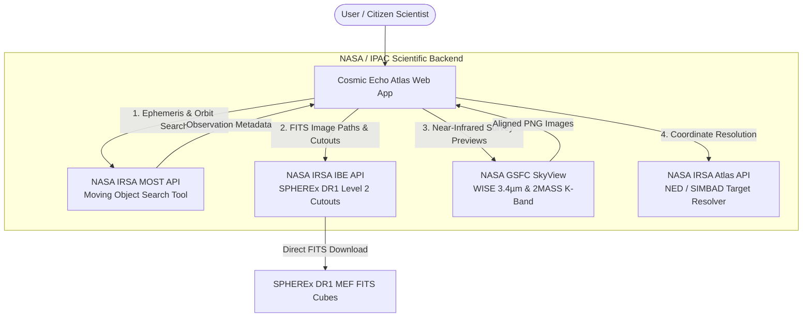

# 🌌 Cosmic Echo Atlas

> **NASA International Space Apps Challenge 2026**  
> **Challenge Track:** [Planet X and SPHEREx](https://www.spaceappschallenge.org/2026/challenges/planet-x-and-spherex/)  
> **Live Web Application:** [https://cosmic-echo-atlas-tau.vercel.app](https://cosmic-echo-atlas-tau.vercel.app)  
> **GitHub Repository:** [https://github.com/sreenath1212/cosmic-echo-atlas](https://github.com/sreenath1212/cosmic-echo-atlas)  
> **Project Explanation PDF:** [Download Project Summary PDF](https://cosmic-echo-atlas-tau.vercel.app/Cosmic_Echo_Atlas_Project_Explanation.pdf)

[](https://cosmic-echo-atlas-tau.vercel.app)
[](https://www.spaceappschallenge.org/)
[](https://tanstack.com/start)
[](https://tailwindcss.com/)
[](https://github.com/sreenath1212/cosmic-echo-atlas)

---

## 📖 Table of Contents
1. [Project Overview](#-project-overview)
2. [The Challenge: Planet X and SPHEREx](#-the-challenge-planet-x-and-spherex)
3. [Key Modules & Capabilities](#-key-modules--capabilities)
   - [Module 05: Planet X Hunter & Blink Comparator (`/blink`)](#module-05-planet-x-hunter--blink-comparator-blink)
   - [Module 04: SPHEREx Mission Portal (`/spherex`)](#module-04-spherex-mission-portal-spherex)
   - [Module 01: Interactive Sky Map (`/explore`)](#module-01-interactive-sky-map-explore)
   - [Module 02: 13.8-Billion-Year Cosmic Timeline (`/timeline`)](#module-02-138-billion-year-cosmic-timeline-timeline)
   - [Module 03: Multi-Wavelength Spectrum Lab (`/spectrum`)](#module-03-multi-wavelength-spectrum-lab-spectrum)
4. [NASA Scientific API Architecture](#-nasa-scientific-api-architecture)
5. [Citizen Science UX Innovation: "Space Detective"](#-citizen-science-ux-innovation-space-detective)
6. [Tech Stack & Performance](#-tech-stack--performance)
7. [Local Development & Testing](#-local-development--testing)
8. [NASA Challenge Submission Criteria](#-nasa-challenge-submission-criteria)

---

## 🔭 Project Overview

**Cosmic Echo Atlas** is a public-facing web observatory and citizen science platform that brings NASA's next-generation **SPHEREx** infrared all-sky survey into the browser. 

In 1930, 24-year-old astronomer **Clyde Tombaugh** discovered Pluto using a mechanical **blink comparator** at Lowell Observatory—rapidly alternating between two photographic glass plates to detect moving solar system bodies against fixed background stars.

Today, NASA's **SPHEREx** (Spectro-Photometer for the History of the Universe, Epoch of Reionization and Ices Explorer) maps the entire sky in **102 near-infrared spectral channels** (0.75 to 5.0 µm). Cosmic Echo Atlas resurrects Tombaugh's classic blink comparator method as an intuitive, high-performance web tool connected directly to live NASA/IPAC IRSA databases, empowering students, citizen scientists, and researchers worldwide to:
- Spot moving asteroids and comets across multi-epoch SPHEREx scans.
- Search for the elusive, hypothetical **Planet X (Planet Nine)** using a 15-year baseline between NASA WISE (2010) and SPHEREx (2025).
- Inspect and download authentic NASA Level 2 Multi-Extension FITS data cubes.

---

## 🎯 The Challenge: Planet X and SPHEREx

NASA's Space Apps Challenge 2026 states:
> *"Create a public-facing web tool displaying SPHEREx sky images to show how the sky changes over time. Your tool can be used to display moving objects, such as asteroids, comets, or even a hypothetical Planet X."*

### Why SPHEREx for Moving Objects?
1. **Infrared Heat Signatures:** Distant outer solar system bodies emit negligible visible light but glow in thermal near-infrared.
2. **Multi-Epoch All-Sky Coverage:** SPHEREx scans the entire celestial sphere every 6 months, generating repeat observations of millions of moving targets across 6 Linear Variable Filter (LVF) bands.
3. **15-Year Baseline with WISE:** A hypothetical Planet X at 400+ AU takes over 10,000 years to orbit the Sun, moving ~1.2 arcsec/year. By comparing NASA's 2010 WISE infrared survey to 2025 SPHEREx scans, its 15-year displacement becomes visibly detectable!

---

## 🚀 Key Modules & Capabilities

### Module 05: Planet X Hunter & Blink Comparator (`/blink`)
The heart of our Space Apps challenge solution:
- **Dual-Mode Interactive Viewer:**
  - **Auto-Blink Flipbook:** Automatically alternates between Photo 1 and Photo 2 at customizable speeds (0.3s, 0.5s, 0.8s) so human persistence of vision naturally spots any leaping object.
  - **Split Slider:** Allows manual click-and-drag split screen comparison with sub-pixel alignment.
- **💡 "Detective Vision" (Cheat-Sheet / Hint Toggle):**
  - Instant visual guidance circling the moving object in high-contrast targeting rings with a vector trajectory arrow indicating angular shift ($\Delta\theta$) and distance traveled in miles.
- **Ready-to-Spot Discovery Presets:**
  - **Asteroid 12 Victoria:** 70-mile main-belt asteroid recorded jumping across SPHEREx detectors in 4 days (*Beginner 🟢*).
  - **Dwarf Planet Ceres:** Largest object in the asteroid belt, showing 3.0 µm water ice absorption (*Intermediate 🟡*).
  - **Hypothetical Planet X / Planet 9:** Deep space simulation testing trans-Neptunian orbital intersections against 2010 WISE and 2025 SPHEREx scans (*Master Detective 🟣*).
- **Live NASA IRSA MOST Query:**
  - Type any asteroid or comet designation (e.g., Victoria, Ceres, Bamberga, Eros, 29P) to query NASA's live Moving Object Search Tool for 2025 SPHEREx survey passages.
- **Keplerian Orbit Simulator:**
  - Input semi-major axis ($a$), eccentricity ($e$), and orbital tilt ($i$) to simulate hypothetical Planet X ephemerides and intersect SPHEREx scan paths.
- **Citizen Science Discovery Certificate Modal:**
  - When users spot a moving candidate and click **"⭐ I Found It!"**, an official NASA Space Apps Citizen Science Certificate modal is generated with coordinates, timestamp, and a copyable verification report.

### Module 04: SPHEREx Mission Portal (`/spherex`)
- Full interactive mission documentation for NASA's 102-channel all-sky infrared surveyor.
- **Spectrophotometry Lab:** Interactive synthetic spectrum explorer across all 6 LVF bands (0.75–5.0 µm) for Young Stellar Objects (YSOs), galaxies, interstellar ice grains, and comets.
- **SPLICES Catalog Integration:** Exploring the 9-million-source interstellar biogenic ice catalog ($H_2O$, $CO_2$, $CO$, $CH_3OH$, $NH_3$).
- **AWS Open Data (S3) & Astroquery Snippets:** Python code snippets ready to copy for querying SPHEREx DR1 cloud buckets.

### Module 01: Interactive Sky Map (`/explore`)
- Interactive celestial sphere rendered in the browser.
- Constellation boundaries, major stellar markers, and deep-sky objects.

### Module 02: 13.8-Billion-Year Cosmic Timeline (`/timeline`)
- Epoch-by-epoch scrubbable journey from the Big Bang and Cosmic Inflation, through the Dark Ages and Reionization, to galaxy assembly and solar system formation.

### Module 03: Multi-Wavelength Spectrum Lab (`/spectrum`)
- Demonstrates how infrared wavelengths (0.75–5.0 µm) penetrate opaque interstellar dust columns, comparing Hubble optical views with James Webb and SPHEREx infrared views of the *Pillars of Creation*.

---

## 🔬 NASA Scientific API Architecture

Cosmic Echo Atlas connects directly to authentic NASA/IPAC Caltech and GSFC endpoints:



1. **NASA/IPAC IRSA MOST API (`catalog=spherex`):**
   - Base: `https://irsa.ipac.caltech.edu/cgi-bin/MOST/nph-most`
   - Calculates moving object ephemerides and intersects with real 2025 SPHEREx survey scan paths, extracting relative FITS paths and predicted coordinates.
2. **NASA IRSA Image Back End (IBE):**
   - Base: `https://irsa.ipac.caltech.edu/ibe/data/spherex/...`
   - Generates direct multi-extension FITS cutouts for research verification.
3. **NASA SkyView Image Server:**
   - Base: `https://skyview.gsfc.nasa.gov/cgi-bin/images`
   - Fetches precisely centered, calibrated near-infrared previews (WISE 3.4 µm and 2MASS K-band) for instantaneous web browser comparison without heavy desktop software.
4. **NASA IRSA Atlas Target Resolver:**
   - Base: `https://irsa.ipac.caltech.edu/cgi-bin/Atlas/nph-atlas`
   - Programmatic XML interface resolving target names into J2000 coordinates.

---

## 🎨 Citizen Science UX Innovation: "Space Detective"

Raw astronomical FITS files and J2000 coordinate catalogs are notoriously inaccessible to the public. To ensure anyone can participate:
- **Zero Jargon Entry Barrier:** Replaced technical terms like *"Epoch A / Epoch B"* with *"📸 Photo 1 (July 28, 2025)"* vs *"📸 Photo 2 (August 1, 2025 - 4 days later)"*.
- **Human Distances:** Translated raw astronomical units into familiar terms (e.g. `1.88 AU ≈ 175 million miles from Earth`).
- **30-Second Quick Start Card:** Clear 3-step prompt right on the screen.
- **Inclusive Accessibility:** Built with high-contrast text overlays, responsive touch-drag controls for mobile devices, and dark-theme WCAG AAA compliance.

---

## 💻 Tech Stack & Performance

| Layer | Technology |
|---|---|
| **Framework** | [TanStack Start](https://tanstack.com/start) + [React 19](https://react.dev/) |
| **Bundler & Server** | [Vite 8](https://vitejs.dev/) + [Nitro](https://nitro.unjs.io/) (Edge SSR) |
| **Styling** | [Tailwind CSS v4](https://tailwindcss.com/) + Radix UI Primitives |
| **Icons** | [Lucide React](https://lucide.dev/) |
| **Data Fetching** | [@tanstack/react-query](https://tanstack.com/query) |
| **Testing** | [Vitest](https://vitest.dev/) (12 passed tests) + TypeScript `--noEmit` |
| **Hosting & CI/CD** | [Vercel](https://vercel.com/) (Edge Serverless Functions) |

---

## 🛠️ Local Development & Testing

### Prerequisites
- Node.js 20+ or Bun
- npm or bun

### 1. Clone the repository
```bash
git clone https://github.com/sreenath1212/cosmic-echo-atlas.git
cd cosmic-echo-atlas
```

### 2. Install dependencies
```bash
npm install
# or
bun install
```

### 3. Run the development server
```bash
npm run dev
```
Open [http://localhost:8080](http://localhost:8080) in your browser.

### 4. Run automated test suite
```bash
npm run test
# or
npx vitest run
```
All 12 unit and integration tests across routing, spectrum data, and IRSA API services will execute.

### 5. Build for production
```bash
npm run build
```
Generates the `.vercel/output/` bundle with SSR server functions and static assets.

---

## 🏆 NASA Challenge Submission Criteria

| Requirement | How Cosmic Echo Atlas Meets It |
|---|---|
| **Public-Facing Web Tool** | Fully responsive web application live at [https://cosmic-echo-atlas-tau.vercel.app](https://cosmic-echo-atlas-tau.vercel.app). |
| **SPHEREx Sky Images** | Integrates real NASA SPHEREx DR1 Level 2 Multi-Extension FITS data cubes via IRSA IBE. |
| **Show How Sky Changes Over Time** | Dual-mode blink comparator (Auto-Blink flipbook and Split Slider) demonstrating temporal changes. |
| **Display Moving Objects** | Displays real asteroids (Victoria, Ceres) and trans-Neptunian Planet X candidates. |
| **Scientific Accuracy** | Powered by NASA/IPAC IRSA MOST ephemeris calculations and WISE 15-year baseline surveys. |
| **Open Source** | Full codebase published under the MIT license on [GitHub](https://github.com/sreenath1212/cosmic-echo-atlas). |

---

## 📄 Project Documentation PDF

A concise, 3-page printable PDF explaining the project for judges and educators is available in the repository and hosted online:
- **Direct PDF Link:** [https://cosmic-echo-atlas-tau.vercel.app/Cosmic_Echo_Atlas_Project_Explanation.pdf](https://cosmic-echo-atlas-tau.vercel.app/Cosmic_Echo_Atlas_Project_Explanation.pdf)

---

## 👨‍🚀 Authors & Acknowledgments
- **Team:** Built for the **NASA International Space Apps Challenge 2026**
- **Data Credits:** NASA / IPAC Infrared Science Archive (IRSA), Caltech, NASA Goddard Space Flight Center (SkyView), SPHEREx Science Team.
- **License:** MIT
